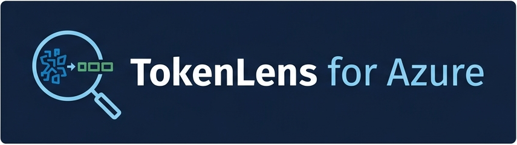
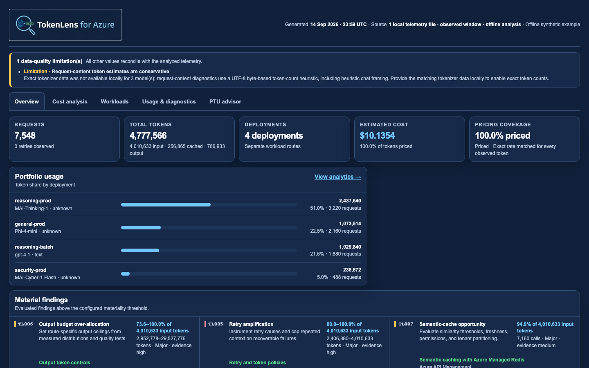
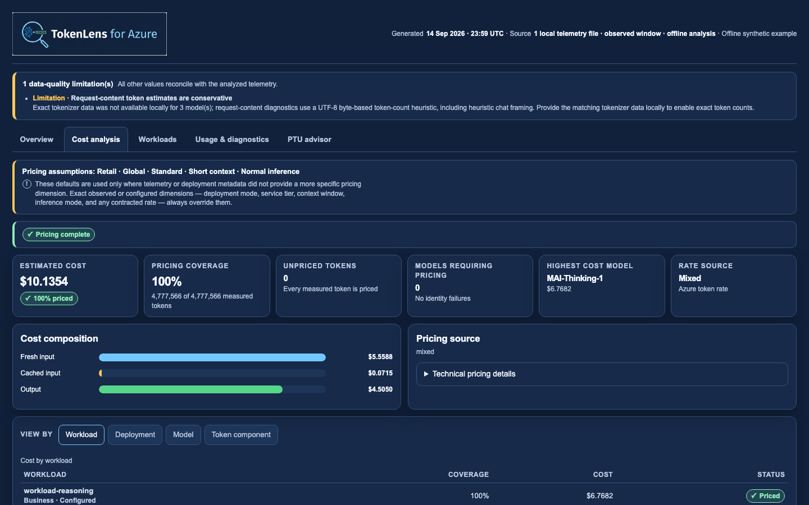
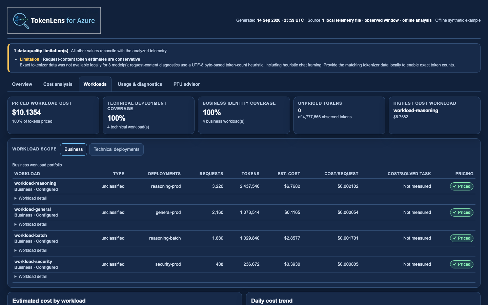
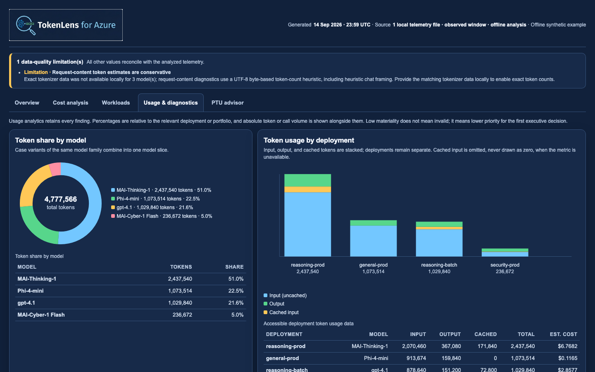
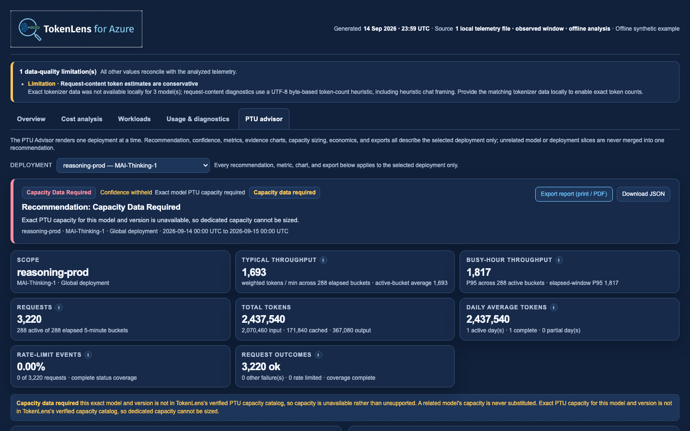

<div align="center">



# TokenLens for Azure

### Understand usage, cost, workloads, and PTU readiness across Microsoft Foundry

[](#status)
[](#quick-start)
[](#privacy)
[](#what-you-get)

</div>

TokenLens discovers your Microsoft Foundry deployments, collects aggregate or
request telemetry, and creates a self-contained report with:

- usage by deployment, model, and workload;
- estimated cost when an exact verified rate is available;
- pricing coverage and clear remediation when it is not;
- PTU suitability and evidence quality;
- request outcomes, throughput, and rate-limit activity;
- token-efficiency diagnostics supported by the available telemetry.
- ranked aggregate operational insights with evidence, confidence, actions, and
  verification steps;
- separate public, contract, Marketplace, override, and actual-cost views.

TokenLens does not send prompts or responses to another service and never guesses
pricing or PTU capacity.

> [!IMPORTANT]
> TokenLens **1.0.1** is the current general-availability release. Pricing, insight,
> telemetry, and report contracts remain conservative when evidence is missing.

## Quick start

## Changelog

### 1.0.1

Patch release: aggregate operational insights are now explicitly presented in
Usage & Diagnostics, and request-level telemetry is described as an optional
precision upgrade rather than a prerequisite for insights.

### 1.0.0

This release candidate contains the GA-track product and release hardening:

- Added zero-touch Foundry collection with chunked long-window merging.
- Added deterministic aggregate insights for coverage, failures, latency
  availability, token footprint, pricing readiness, and cache evidence.
- Added exact public pricing from Azure Retail Prices API and official Foundry
  provider pages, including Ministral-3B fine-tuned inference meters.
- Added separate actual-cost, contract, Marketplace, and override pricing
  tracks.
- Added typed report payloads, materiality/help links, bounded analytics, and
  improved responsive insight layout.
- Corrected GPT-5.6 cache semantics: sub-1,024-token aggregate input proves
  cached tokens are zero; otherwise cached usage remains unavailable unless
  request-level usage is collected.
- Removed the empty Not evaluated and Azure actions report panels.

This is the first general-availability release. It is supported according to
the runtime and limitation matrix in `docs/support-matrix.md`.

### 1. Install

```bash
git clone https://github.com/zakarel/tokenlens-for-azure.git
cd tokenlens-for-azure
python3 -m venv .venv
.venv/bin/python -m pip install -e ".[foundry,foundry-claude,foundry-monitor]"
```

### 2. Sign in

```bash
az login
```

### 3. Run TokenLens

```bash
.venv/bin/tokenlens-azure foundry
```

That is the only TokenLens command most users need.

Assessment modes are explicit:

```bash
tokenlens-azure foundry configure --assessment-mode operational
tokenlens-azure foundry configure --assessment-mode optimization
tokenlens-azure foundry configure --assessment-mode full
```

Operational mode uses deployment inventory, Azure Monitor, pricing, workloads,
PTU evidence, and actionable aggregate insights by default. Optimization mode
uses SDK, OpenTelemetry, Application Insights, or JSONL request telemetry for
TL001-TL008. Full mode runs both tracks; aggregate telemetry alone never claims
request-level optimization, and the report explains that request telemetry is
an optional precision upgrade rather than a prerequisite for insights.

The wizard:

1. checks local readiness;
2. asks whether to inspect all accessible subscriptions or one subscription;
3. discovers Foundry accounts and every deployment in scope;
4. asks for the analysis window;
5. refreshes cached public pricing if needed, then checks pricing readiness;
6. collects each deployment with visible progress;
7. creates technical workloads automatically;
8. generates and opens the report.

## What the wizard looks like

```text
╭──────────────────── TokenLens Foundry ────────────────────╮
│ Full assessment · Usage · Cost · Workloads · PTU          │
╰────────────────────────────────────────────────────────────╯

Step 1/4 · Subscription scope
  1. All accessible subscriptions
  2. One specific subscription

Step 2/4 · Foundry accounts
  ✓ example-foundry-account · East US 2

Step 3/4 · Deployments
  ✓ reasoning-prod · GPT-5.6 Luna · Global Standard
  ✓ coding-prod    · Claude Opus 5 · Global Standard
  ✓ compact-prod   · Ministral 3B   · Global Standard

All 3 deployments will be collected.

Step 4/4 · Analysis window
  1. 7 days
  2. 14 days — recommended
  3. 30 days
  4. 90 days

Pricing readiness
  Pricing assumptions: Retail · Global · Standard · Short context · Normal inference
  ✓ reasoning-prod · exact retail rate
  ✓ coding-prod    · Claude CCU-equivalent rate
  ⚠ compact-prod   · exact rate unavailable

Collecting deployments
  reasoning-prod  ━━━━━━━━━━━━━━━━━━━  complete
  coding-prod     ━━━━━━━━━━━━━━━━━━━  complete
  compact-prod    ━━━━━━━━━━━━━━━━━━━  complete

Collection complete
  3 / 3 deployments succeeded
  Report opened
```

The exact presentation depends on terminal capabilities. `NO_COLOR` and
non-interactive terminals receive a plain-text equivalent.

## What you get

| View | Answers |
|---|---|
| **Overview** | What happened, what is measurable, and what needs attention? |
| **Cost analysis** | What is priced, what remains unpriced, and why? |
| **Workloads** | What does each deployment, application, agent, or process cost? |
| **Usage & diagnostics** | Which models and deployments consume tokens, and which diagnostics were evaluated? |
| **PTU advisor** | Is PTU applicable, is there enough evidence, and what capacity or pricing data is missing? |

### Overview

<a href="docs/assets/tokenlens-report-overview-1.0.1.png">
  
</a>

### Cost analysis

<a href="docs/assets/tokenlens-report-cost-analysis-1.0.1.png">
  
</a>

### Workloads

<a href="docs/assets/tokenlens-report-workloads-1.0.1.png">
  
</a>

### Usage & diagnostics

<a href="docs/assets/tokenlens-report-usage-diagnostics-1.0.1.png">
  
</a>

### PTU advisor

<a href="docs/assets/tokenlens-report-ptu-advisor-1.0.1.png">
  
</a>

<p align="center"><em>All screenshots use deterministic synthetic data.</em></p>

## Possible findings

TokenLens only reports a finding when the required evidence exists. Aggregate
Azure Monitor scans produce operational findings by default; request-level
findings require compatible request telemetry.

| Finding | Evidence | Typical recommendation |
|---|---|---|
| Rate-limit or failure hotspot | Aggregate status-code coverage | Investigate throttling, capacity, retry policy, or failed routes |
| Latency degradation or missing latency | Azure latency metrics | Compare affected deployments and validate the observation window |
| Token footprint concentration | Aggregate input/output token totals | Focus optimization on the highest-volume deployment or workload |
| Pricing gap or incomplete cost | Exact model, unit, and usage coverage | Add a verified rate or treat the priced subtotal separately |
| Cache evidence gap | Cached-token metric or request usage | Import request usage before making cache-efficiency conclusions |
| PTU evidence gap or recommendation | Active-bucket, eligibility, capacity, and price evidence | Validate traffic representativeness before committing capacity |
| Repeated system prefix (TL001) | Request messages or contentless prompt fingerprints | Reuse stable prefixes and review prompt construction |
| Conversation-history growth (TL002) | Per-request message history | Trim or summarise unnecessary context |
| Unused tool definitions (TL003) | Tool definitions and call sites | Send only tools applicable to the request |
| Retrieval redundancy (TL004) | Retrieved chunks per request | Deduplicate and reduce repeated context |
| Retry amplification (TL005) | Retry metadata, retry counts, or request evidence | Bound retries and avoid replaying oversized context |
| Output budget over-allocation (TL006) | Output limits and observed output distribution | Set route-specific output ceilings |
| Semantic-cache opportunity (TL007) | Request content suitable for equivalence comparison | Evaluate cache thresholds, freshness, and tenant isolation |
| Possible model over-sizing (TL008) | Model identity plus task-shape evidence | Validate quality before considering a smaller model |

“Not evaluated” means the evidence was unavailable; it is never presented as a
clean bill of health.

## Workload cost

Every deployment automatically appears as a **technical workload**, so workload
cost is visible even when no business metadata is configured.

You can later enrich a dedicated deployment with a business workload such as an
application, agent, API, or business process.

For shared deployments, business allocation requires an explicit workload tag
from SDK or OpenTelemetry instrumentation. TokenLens does not divide shared cost
arbitrarily. Untagged traffic remains visible as **Unassigned**.

## Pricing

Estimates use these defaults wherever telemetry or deployment metadata does not
state the dimension, and the report says so in bold at the top of Cost analysis:

> **Pricing assumptions: Retail · Global · Standard · Short context · Normal inference**

An exact observed or configured dimension — deployment mode, service tier,
context window, inference mode, or a contracted rate — always overrides a
default.

Rates come from official sources, cached locally and read offline:

- the **Azure Retail Prices API** for Foundry Models token meters;
- the official Microsoft Foundry provider pricing pages when a published rate
  is not present in Retail Prices API;
- **Anthropic's published Claude pricing** (USD only), converted to Foundry
  consumption units at 100 CCU = $1 and labelled as a CCU-derived estimate, not
  an Azure token meter. Customer-specific private discounts are not included.

Cost estimation still requires an exact match for model, deployment mode,
service tier, currency, and billing basis. TokenLens does not substitute a
related model, merge catalogs across currencies, or convert one. Fine-tuning,
batch, priority, flex, and provisioned meters are excluded from
normal-inference estimates, and a pricing feed that could not be read to
completion is reported as truncated rather than cached.

If pricing is unresolved, usage and operational analysis still work. The report
shows the affected deployment, excluded tokens, reason, and next safe action.

Use the nested pricing workflow for synchronization, imports, and provenance:

```bash
tokenlens-azure foundry pricing sync --source all
tokenlens-azure foundry pricing audit
tokenlens-azure foundry pricing import-pricesheet FILE
tokenlens-azure foundry pricing import-cost-details FILE
tokenlens-azure foundry pricing provenance
```

Actual billed cost is reconciled separately from forward estimates. Unattributed
Cost Details rows remain visible rather than being assigned by guesswork.

## PTU states

| State | Meaning |
|---|---|
| **PTU recommended** | Evidence and economics support a commitment. |
| **Borderline** | Validate with more representative traffic before committing. |
| **PAYG recommended** | PAYG better fits the observed workload. |
| **Insufficient evidence** | Too few active five-minute buckets support a decision. |
| **Capacity data required** | Exact PTU capacity for this model/version is not verified. |
| **PTU not applicable** | The partner/Marketplace model has no Azure PTU purchase model. |

Claude and Mistral deployments can legitimately show **PTU not applicable**.
That is different from an error.

## Privacy

Collection uses Azure Resource Manager and Azure Monitor. Analysis runs locally.

By default TokenLens does **not** collect prompts, responses, system messages,
tool content, retrieved documents, credentials, user identities, or IP addresses.

Request-content diagnostics use exact local tokenizer assets only when they are
already cached. TokenLens never downloads tokenizer data during analysis. If an
asset is missing, the report identifies the UTF-8 byte-based token heuristic as
low-confidence; aggregate Azure Monitor token metrics remain source-reported.

Local configuration, telemetry, reports, pricing overrides, and run state are
excluded from Git. Reports omit local source paths and Azure subscription or
tenant identifiers.

## Documentation

- [Pricing methodology and provenance](docs/pricing.md)
- [Contributing](CONTRIBUTING.md)
- [Code of Conduct](CODE_OF_CONDUCT.md)
- [Security and privacy](SECURITY.md)
- [Support matrix and limitations](docs/support-matrix.md)
- [Third-party notices](THIRD_PARTY_NOTICES.md)
- Built-in help is available from the guided command

## Status

TokenLens is advisory. Estimated costs are not invoices, and PTU results are not
contractual capacity commitments. Validate recommendations against your
agreement, regional availability, quality requirements, and representative
production traffic.

## License

[MIT](LICENSE)
